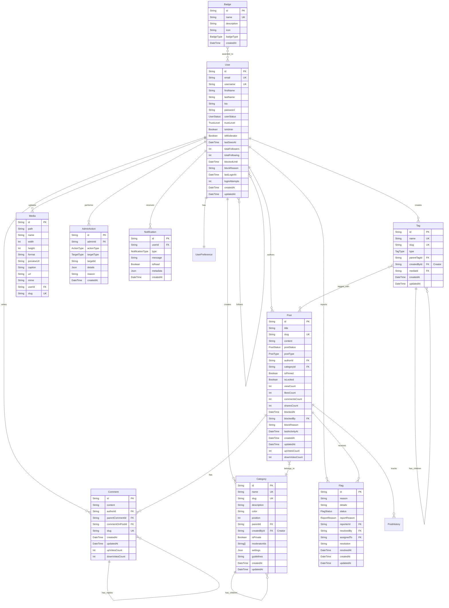

# Database Design for Discourse Alternative

## Core Features

### User System

- Users have trust levels (New, Basic, Member, Regular, Leader)
- Users can be administrators or moderators
- Users can follow/be followed
- Users can earn badges
- Users have activity statistics

### Category & Tag System

- Categories are hierarchical (main categories and sub-categories)
- Tags can be hierarchical (parent-child relationships)
- Both support media attachments
- Both support full-text search
- Both can be followed by users

### Post System

- Posts belong to categories
- Posts can have multiple tags
- Posts support versioning (PostHistory)
- Posts can be flagged for moderation
- Posts track view counts and activity

### Interaction System

- Users can like, bookmark, and share posts
- Users can vote on comments
- Users can flag inappropriate content
- Users receive notifications
- Users can follow content

## Admin Features

### 1. User Management

- **Block/Unblock Users**
  - Block users for violations
  - Set block duration (temporary/permanent)
  - Add block reason and notes
  - View block history
  - Unblock users manually
  
- **User Activity Monitoring**
  - View user activity logs
  - Track login attempts
  - Monitor reported content
  - Review user contributions
  - Check trust level progression

### 2. Content Moderation

- **Post Management**
  - Block/unblock posts
  - Delete inappropriate content
  - Review reported posts
  - Pin/unpin important posts
  - Lock/unlock discussions
  
- **Comment Management**
  - Hide/show comments
  - Delete inappropriate comments
  - Review reported comments
  - Manage nested replies
  - Track edited comments

### 3. Category Administration

- **Category Structure**
  - Create new categories
  - Edit category details
  - Manage category hierarchy
  - Set category permissions
  - Delete/merge categories
  
- **Category Settings**
  - Set posting guidelines
  - Configure auto-moderation
  - Assign category moderators
  - Define required tags
  - Set visibility rules

### 4. Tag Management

- **Tag Organization**
  - Create/edit/delete tags
  - Manage tag hierarchies
  - Set tag descriptions
  - Control tag usage
  - Merge similar tags
  
- **Tag Settings**
  - Set tag permissions
  - Configure tag suggestions
  - Define tag relationships
  - Set tag visibility
  - Track tag usage

### 5. Admin Tools

- **Dashboard**
  - Activity overview
  - Moderation queue
  - Recent actions log
  - System health metrics
  - User statistics

- **Audit System**
  - Track admin actions
  - View change history
  - Monitor permission changes
  - Export audit logs
  - Set retention policies

### 6. Permission Management

- **Role-Based Access**
  - Define admin roles
  - Set role permissions
  - Manage role assignments
  - Create custom roles
  - Track role changes

- **Permission Levels**

  ```typescript
  enum AdminPermissionLevel {
    SUPER_ADMIN     // Full system access
    ADMIN           // General administration
    MODERATOR       // Content moderation
    CATEGORY_ADMIN  // Category management
    TAG_ADMIN       // Tag management
  }
  ```

### 7. Reporting System

- **Content Reports**
  - Review reported items
  - Track report status
  - Assign to moderators
  - Set resolution actions
  - Notify reporters

- **Report Categories**
  
  ```typescript
  enum ReportReason {
    SPAM
    HARASSMENT
    INAPPROPRIATE
    COPYRIGHT
    MISINFORMATION
    OTHER
  }
  ```

### 8. System Configuration

- **Site Settings**
  - General configuration
  - Feature toggles
  - Theme management
  - API settings
  - Cache control

- **Automated Tasks**
  - Content cleanup
  - User trust updates
  - Statistics generation
  - Backup scheduling
  - Log rotation

### 9. Analytics & Reporting

- **Usage Statistics**
  - User engagement
  - Content metrics
  - Moderation actions
  - Performance data
  - Growth trends

- **Custom Reports**
  - Generate custom reports
  - Export data
  - Schedule reports
  - Set alerts
  - Track trends

### 10. Communication Tools

- **Announcements**
  - Site-wide notices
  - Category announcements
  - User notifications
  - Email communications
  - System alerts

- **Templates**
  - Email templates
  - Notification formats
  - Response templates
  - Warning messages
  - Welcome messages

## Database Schema



## Key Enums

```typescript
enum UserStatus {
    UNVERIFIED
    VERIFIED
    BLOCKED
}

enum TrustLevel {
    NEW
    BASIC
    MEMBER
    REGULAR
    LEADER
}

enum PostType {
    TOPIC
    REPLY
    WIKI
    PRIVATE_MESSAGE
    SMALL_ACTION
}

enum PostStatus {
    DRAFT
    PUBLISHED
    ARCHIVED
    TRASHED
    BLOCKED
}

enum TagType {
    TAG
    CATEGORY
}

enum BadgeType {
    BRONZE
    SILVER
    GOLD
}

enum FlagStatus {
    PENDING
    APPROVED
    REJECTED
    RESOLVED
    DEFERRED
}

enum NotificationType {
    MENTION
    REPLY
    QUOTE
    LIKE
    FOLLOW
    BADGE
    SYSTEM
}
```

## Important Indexes

```sql
-- User indexes
CREATE INDEX idx_user_username ON "User"(username);
CREATE INDEX idx_user_email ON "User"(email);
CREATE INDEX idx_user_trust_level ON "User"(trustLevel);
CREATE INDEX idx_user_last_seen ON "User"(lastSeenAt);

-- Post indexes
CREATE INDEX idx_post_author_status ON "Post"(authorId, postStatus);
CREATE INDEX idx_post_status_created ON "Post"(postStatus, createdAt);
CREATE INDEX idx_post_view_count ON "Post"(viewCount);
CREATE INDEX idx_post_title_search ON "Post" USING GIN (titleSearch);
CREATE INDEX idx_post_content_search ON "Post" USING GIN (contentSearch);

-- Comment indexes
CREATE INDEX idx_comment_post ON "Comment"(commentOnPostId);
CREATE INDEX idx_comment_parent ON "Comment"(parentCommentId);
CREATE INDEX idx_comment_author ON "Comment"(authorId);
CREATE INDEX idx_comment_content_search ON "Comment" USING GIN (contentSearch);

-- Tag indexes
CREATE INDEX idx_tag_name ON "Tag"(name);
CREATE INDEX idx_tag_type ON "Tag"(type);
CREATE INDEX idx_tag_slug ON "Tag"(slug);
CREATE INDEX idx_tag_name_search ON "Tag" USING GIN (nameSearch);

-- Category indexes
CREATE INDEX idx_category_parent ON "Category"(parentId);
CREATE INDEX idx_category_position ON "Category"(position);
CREATE INDEX idx_category_slug ON "Category"(slug);

-- Flag indexes
CREATE INDEX idx_flag_status ON "Flag"(status);
CREATE INDEX idx_flag_reporter ON "Flag"(reporterId);
CREATE INDEX idx_flag_post ON "Flag"(postId);
CREATE INDEX idx_flag_comment ON "Flag"(commentId);
CREATE INDEX idx_flag_created ON "Flag"(createdAt);

-- Media indexes
CREATE INDEX idx_media_name ON "Media"(name);
CREATE INDEX idx_media_user ON "Media"(userId);
CREATE INDEX idx_media_mime ON "Media"(mime);
```

## Key Features Implementation

1. **Full-Text Search**
   - Uses PostgreSQL tsvector for efficient search
   - Indexes on post title and content
   - Indexes on comment content
   - Indexes on tag names

2. **Hierarchical Content**
   - Categories with parent-child relationships
   - Tags with optional parent-child structure
   - Comments with nested replies

3. **Activity Tracking**
   - Post view counts
   - Last activity timestamps
   - User engagement metrics
   - Content popularity tracking

4. **Moderation System**
   - Flag queue for content moderation
   - User trust levels
   - Content status management
   - Revision history tracking

5. **Media Management**
   - Support for various media types
   - Preview URL generation
   - Media metadata storage
   - User-based media organization
