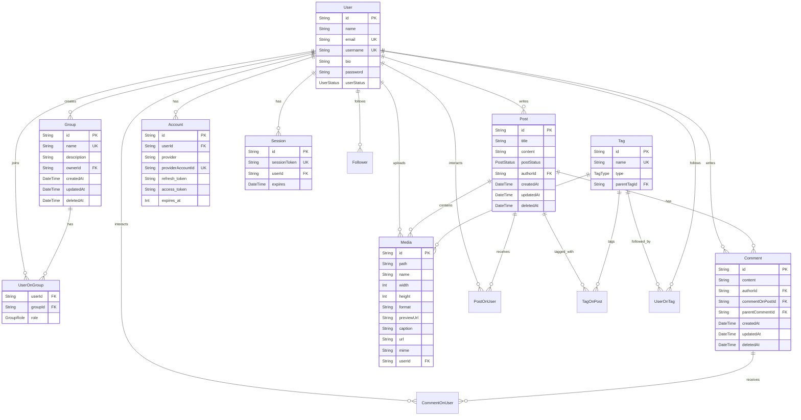

# Database design

## Table design

- User can create many Groups, Group can have many Users
- User can be Editor, Moderator, Admin
- User can create many Posts, Post can have many Comments and Images
- User can create Comments on Posts
- User can like, share, up vote, down vote a Post
- User can Tag a Post
- Tag have two type: Tag or Category
- Tag can have many Images
- Comments can be nested
- Tag can be nested (Child & Parent relationship)
- User can like, share, up vote, down vote, book mark, pin a Post
- User can like, share, up vote, down vote a Comment
- User can follow/unfollow other users
- User can follow/unfollow a tag
- Post can be STANDARD, ASIDE, GALLERY, LINK, IMAGE, QUOTE, STATUS, VIDEO, AUDIO, POLL
- Post's status can be: DRAFT, PUBLISHED, ARCHIVED, TRASHED, BLOCKED
- User's status can be: UNVERIFIED, VERIFIED, BLOCKED

